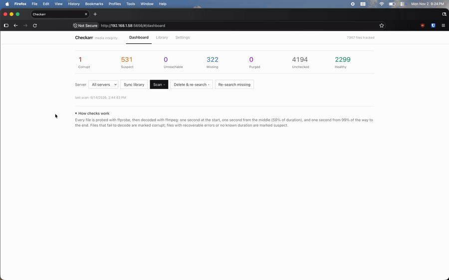

<p align="center">
  
</p>

# Checkarr

A locally hosted media integrity checker for Radarr and Sonarr libraries. It actually plays every file and flags the ones that don't.

**1.0.0 · Node 23.4+ · Radarr + Sonarr · MIT**

[](LICENSE)  



- [Features](#features) · [How it works](#how-it-works) · [Try it in 30 seconds](#try-it-in-30-seconds) · [Install](#install) · [Configuration](#configuration) · [API](#api) · [For developers](#for-developers) · [Security](#security) · [License](#license)

## Features

- **Really plays your media.** Every file is decoded with ffmpeg at the start, middle, and end, not just stat'ed.
- **The \*arr is the source of truth.** Every monitored movie/episode gets a row, downloaded or not. Not-yet-downloaded items show as missing instead of being invisible.
- **See why it failed.** Per-file ffmpeg findings show exactly what the decoder reported.
- **Fix it in one click.** Delete & re-search (single file or bulk) and Re-search missing queue replacements at the \*arr.
- **Never acts on stale data.** Every scan, re-check, purge, and search syncs from the \*arr first.
- **Runs anywhere.** macOS, Linux, and Windows, Docker, plus a desktop icon and tray icon for daily use.

## How it works

1. **Sync libraries.** Checkarr pulls what should exist from Radarr/Sonarr.
2. **Check files.** ffprobe parses the container, then ffmpeg decodes video and audio streams into the null muxer.
3. **Review the dashboard.** Anything that fails shows up flagged with its decoder output.
4. **Fix or re-search.** Purge the bad file at its \*arr source and search for a replacement.

Browsers can only decode a handful of codecs, so ffmpeg is the "player":

- **Start check.** Decode the first second of every stream ("open it and play it")
- **Middle check.** Input-seek to 50% of duration and decode a second ("does it keep playing?")
- **End check.** Input-seek to 99% of duration and decode a second ("does it finish?")

### Verdicts

| Status        | Meaning                                                                                                                  |
| ------------- | ------------------------------------------------------------------------------------------------------------------------ |
| `healthy`     | Probe + all decode checks clean                                                                                          |
| `corrupt`     | Container unparseable or a decode check failed                                                                           |
| `suspect`     | Recoverable decode errors, unknown duration, or a timeout                                                                |
| `missing`     | The \*arr references a file that no longer exists, or a monitored item with no file yet (not downloaded)                 |
| `unreachable` | The file exists but is not readable (permissions)                                                                        |
| `purged`      | Deleted at the \*arr via Delete & re-search and waiting for its replacement; stays purged (never missing) until it lands |
| `unchecked`   | Synced but not checked yet                                                                                               |

Files with no known duration never come back `healthy`: the middle and end checks can't run, so `suspect` is the best possible verdict.

## Try it in 30 seconds

No real \*arr instance needed. Use the stub sources and sample media:

```bash
pnpm install
pnpm gen:samples       # writes healthy/truncated/damaged files to data/sample-media
pnpm stub:arr          # fake Radarr on :8699, fake Sonarr on :8698, api key: checkarr-stub-key
pnpm dev:server        # API + UI on http://127.0.0.1:5656
```

Then in the dashboard:

1. Go to Settings, add `http://127.0.0.1:8699` and `http://127.0.0.1:8698` with key `checkarr-stub-key`, test them.
2. Hit **Sync libraries** on the Dashboard, then start a scan.
3. You should get 2 healthy, 1 corrupt (truncated), 1 suspect (middle damage), 1 missing (ghost file).

## Install

**Requirements:** Node 23.4+ (`node:sqlite`) and pnpm 11. ffmpeg and ffprobe ship via `ffmpeg-static` / `ffprobe-static`, downloaded during `pnpm install`. No system ffmpeg needed except in Docker (see below).

No terminal? After cloning, double-click `Checkarr.command` in Finder (macOS). It installs dependencies on first run, starts the server, opens the dashboard, and installs the app icon below — so the next launch is one click in Launchpad.

### Quick start (dev)

```bash
pnpm install
pnpm dev:server        # API + UI on http://127.0.0.1:5656
pnpm dev:web           # optional: Vite dev server with HMR on http://localhost:5173
```

Open http://127.0.0.1:5656, go to Settings, add your Radarr/Sonarr instance (URL + API key. Find it under Settings > General in the \*arr web UI), test it, then hit **Sync libraries** and start a scan.

### Production build

```bash
pnpm build
pnpm start             # builds, kills any running instance, starts fresh, waits until healthy
pnpm stop              # stops it again
```

`pnpm start` detaches the server: it logs to `data/server.log`, writes its pid to `data/checkarr.pid`, and the terminal is free to close. It also opens the dashboard and parks a tray icon while the server runs (see below). Both scripts are plain Node, so they work on macOS, Linux, and Windows (no WSL needed). `CHECKARR_PORT`/`PORT` are honored by both scripts. Foreground die-hards: `pnpm -F @checkarr/server start`.

`CHECKARR_NO_TRAY=1` (skip tray icon) or `CHECKARR_NO_OPEN=1` (skip opening the dashboard) tune the start behavior; `pnpm stop` leaves the icon alone when `CHECKARR_NO_TRAY=1` is set.

### Desktop icon

`pnpm start` also installs an app-drawer icon for this checkout (a no-op once up to date):

- **macOS.** `~/Applications/Checkarr.app`, visible in Launchpad and Spotlight (compiles a tiny launcher on install, so the Xcode Command Line Tools are needed once: `xcode-select --install`)
- **Linux.** `~/.local/share/applications/checkarr.desktop` plus a hicolor icon
- **Windows.** A Start-menu shortcut

Double-clicking the icon starts the server if it is not running (rebuilding only when source is newer than build output) and opens http://127.0.0.1:5656. Clicking it again while the server is up just opens the dashboard. Re-run `pnpm app:install` after moving the checkout or switching Node; `pnpm app:uninstall` removes the icon. Everything the icon does is logged to `data/launcher.log` (Finder-launched apps have no terminal).

`CHECKARR_NO_DESKTOP_APP=1 pnpm start` skips the icon entirely. It is useful for scripts and CI.

### Tray icon

`pnpm start` also puts an icon where the platform keeps running apps, while the server runs:

- **macOS.** The menu bar (a template check mark, tinted by the system)
- **Windows.** The notification area, behind the `^` chevron on Windows 11
- **Linux.** A `yad --notification` item, when [yad](https://github.com/v1cont/yad) is installed. Without yad the icon is skipped and start says so

Clicking it opens **Open Checkarr** (restarts the server first if it stopped), **Open log**, and **Stop Checkarr** (stops the server and removes the icon). The icon is a separate detached process, so it survives closing the terminal and a server crash. `pnpm stop` is what takes it down. `pnpm start` reuses a running icon instead of stacking a second one, and everything it does lands in `data/tray.log`.

### Docker

```bash
cd docker
docker compose up -d --build
```

The image uses system ffmpeg (no bundled download) and stores data in the `checkarr-data` volume. Mount your media into the container and add path mappings in Checkarr settings when the \*arr-reported paths differ from the container paths:

```yaml
# in docker/docker-compose.yml volumes:
# - /path/to/movies:/data/movies:ro
# - /path/to/tv:/data/tv:ro
# e.g. match /movies -> /data/movies
```

## Configuration

Settings live in SQLite (`data/checkarr.db`, override the directory with `CHECKARR_DATA_DIR`):

- **Sources.** Radarr/Sonarr base URL + API key
- **Path mappings.** Ordered prefix rewrites from \*arr paths to local paths
- **Concurrent checks.** 1–32 parallel ffmpeg workers (default 8)
- **ffmpeg/ffprobe path overrides.** Use system binaries instead of the bundled ones
- **Local broadcasting.** Bind `0.0.0.0` instead of loopback so other devices on your network can open the dashboard (no authentication, trusted networks only). Saves with the rest of the settings and takes effect on "Restart server". An explicit `HOST` environment variable overrides it.
- **Re-search missing.** One click tells the \*arr to search for every missing item in scope (Radarr `MoviesSearch` / Sonarr `EpisodesSearch`). The library syncs first so the search list reflects what the \*arr currently reports.

Environment: `CHECKARR_PORT` (default 5656; 6767 belongs to Bazarr), `HOST` (default 127.0.0.1), `CHECKARR_DATA_DIR`, `CHECKARR_WEB_DIST`, `LOG_LEVEL`.

## API

<details>
<summary>Full endpoint list (click to expand)</summary>

```text
GET    /api/stats                     counts by status and by source + last scan
GET    /api/settings                  settings + resolved binaries
PUT    /api/settings                  update settings (concurrency, paths, mappings)
GET    /api/sources                   list sources
POST   /api/sources                   { type, name, baseUrl, apiKey }
PUT    /api/sources/:id               update source
DELETE /api/sources/:id               delete source and its files
POST   /api/sources/:id/test          verify URL + key (GET /api/v3/system/status)
POST   /api/sync                      pull libraries from all enabled sources (or { sourceId }); 409 while a scan runs
POST   /api/scan                      { scope: unchecked|corrupt|suspect|missing|unreachable|purged|all, sourceId? } - syncs first
POST   /api/purge                     { status: corrupt|suspect|all, sourceId? } delete files at the *arr + search replacements; deleted files move to purged
POST   /api/files/:id/purge           delete one file at its *arr source + search replacement (syncs the item first)
POST   /api/scan/cancel               stop the running scan
POST   /api/research                  queue searches at the *arr for every missing item (or { sourceId }); syncs first; 409 while a scan runs
GET    /api/scan/current              progress of the active/last run
GET    /api/files?status=&sourceId=&q=&page=&pageSize=&sort=title|status|size|checked&dir=asc|desc    library listing
GET    /api/files/:id                 full detail incl. ffmpeg findings
POST   /api/files/:id/recheck         re-run the quick check on one file (syncs the item from the *arr first)
GET    /api/files/:id/stream          Range-aware streaming for the browser player
```

</details>

## For developers

```bash
pnpm test              # vitest: scripts + unit + ffmpeg integration + sync tests
pnpm -F @checkarr/server dev
pnpm -F @checkarr/web dev
```

### Repository layout

```text
apps/server   Fastify API, SQLite (node:sqlite), scan engine (TypeScript)
apps/web      React + Vite + Tailwind UI
scripts       start/stop/launch, the desktop + tray icons, shared lib
scripts/dev   sample media generator + stub Radarr/Sonarr for local testing
docker        Dockerfile + compose file
```

## Security

- The server binds to `127.0.0.1` by default and has **no authentication**. Do not expose it to the internet as-is. "Local broadcasting" opens it to the LAN. The API also answers `POST /api/restart`, so anyone on the network can bounce the listener.
- API keys sit in the local database as plaintext.
- Checkarr never modifies Radarr/Sonarr library metadata except through explicit actions: per-file and bulk Delete & re-search, and Re-search missing.
- Every operation that touches the library syncs first: per-file operations (Re-check now, per-file Delete & re-search) sync that one item, and batch operations (scan, bulk delete) run the same library sync as the "Sync libraries" button. A 404 at the \*arr removes the row, a newly downloaded file is picked up right away, and a \*arr outage fails the request instead of acting on stale data.
- A scan checks every file independently; killing the server mid-scan leaves remaining files unchecked, and the next scan (scope `unchecked`) picks them up.

## License

Checkarr is MIT-licensed. See [`LICENSE`](LICENSE).
